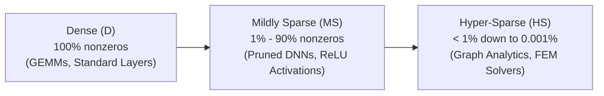
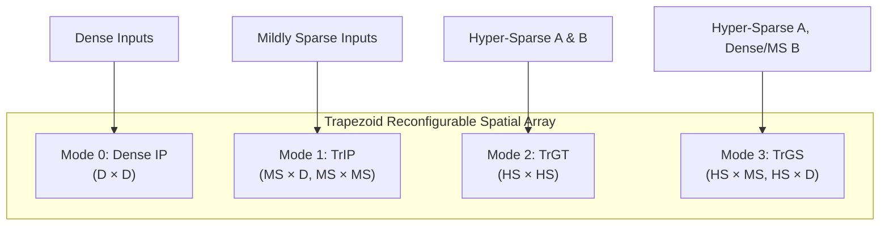
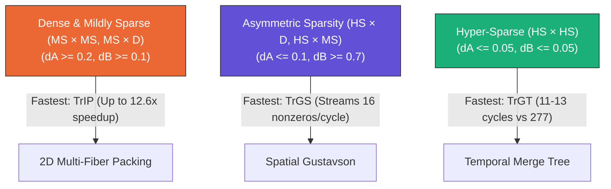

# Trapezoid: Comprehensive Architecture, RTL Implementation, & Experimental Results Guide

*Prepared for Academic Presentation and Defense with Your Professor*

---

## 1. High-Level Motivation: The Sparsity Dilemma

Matrix multiplication ($C = A \times B$) is the foundational operation for deep learning (transformers, CNNs), scientific computing, and graph analytics. However, real-world workloads exhibit a wide spectrum of sparsity:



### Prior Accelerators and Their Fundamental Trade-Offs

| Accelerator Architecture                          | Target Domain                                                                                                                                        | Peak Compute Density            | Inherent Flaw in Other Regimes                                                                              |
| ------------------------------------------------- | ---------------------------------------------------------------------------------------------------------------------------------------------------- | ------------------------------- | ----------------------------------------------------------------------------------------------------------- |
| **TPU / Tensor Cores** (Dense IP Array)     | Dense ($D \times D$)                                                                                                                               | Very High (90%+ area on MACs)   | Inflexible: multiplies every zero. Efficiency plummets as sparsity increases.                               |
| **SIGMA / DSTC** (Mildly Sparse Arrays)     | Mildly Sparse ($MS$) | Medium-High (Benes network + MACs) | Inefficient when both matrices are sparse ($MS \times MS$) or hyper-sparse ($HS$). |                                 |                                                                                                             |
| **Flexagon / Gamma** (Hyper-Sparse Engines) | Hyper-Sparse ($HS \times HS$)                                                                                                                      | Very Low (< 5-10% area on MACs) | Devotes most area to caches/buffers to manage gather traffic; orders-of-magnitude slower on dense matrices. |

### The Core Contribution of Trapezoid (ISCA 2024)

Instead of forcing a single fixed dataflow, **Trapezoid treats dataflow as an architectural parameter**. It reuses a unified 2D spatial array to support **four specialized dataflows** based on the sparsity characteristics of the inputs:



---

## 2. In-Depth RTL Code Walkthrough (File-by-File)

The repository provides a complete, cycle-accurate SystemVerilog implementation of the Trapezoid compute fabric.

```
Trapezoid/
├── mfiu.sv             <- Multi-Fiber Intersection Unit (Combinational core of TrIP)
├── trip_row.sv         <- Dual-mode PE Row (Dense IP & TrIP) with dynamic packing
├── trgt_sub.sv         <- Temporal Gustavson Subrow engine (for HS x HS)
├── trgs_row.sv         <- Spatial Gustavson PE Row engine (for HS x MS & HS x D)
├── trapezoid_top.sv    <- Top-level accelerator: scheduler, dispatch, writeback, counters
├── tb_dense.sv         <- Unit test for Dense IP mode
├── tb_trip.sv          <- Unit test for TrIP mode
├── tb_trgt.sv          <- Unit test for TrGT mode
├── tb_trgs.sv          <- Unit test for TrGS mode
├── tb_top.sv           <- System-level testbench: 260-run sweep across 8x8 density grid
├── run_all.py          <- Automated test harness & summary generation
├── plot_results.py     <- Publication figure generation
├── parameters.json     <- Newly added customizable configuration file
└── run_sweep.py        <- Newly added parameter sweep driver
```

---

### [mfiu.sv](file:///c:/Users/harsh/OneDrive/Desktop/Independent-Study-M-26/Trapezoid/mfiu.sv) — Multi-Fiber Intersection Unit

*Paper Section III-B, Figures 10–12*

#### 1. Why is it needed?

In a standard inner product with sparse inputs, intersecting one row of $A$ with one column of $B$ yields an effectual computation only when both elements at coordinate $k$ are nonzero. If density is $p = 20\%$, the chance of a match is $p^2 = 4\%$, meaning 96% of cycles would be wasted.
The **MFIU** solves this by intersecting **$RA$ rows of $A$ with $CB$ columns of $B$ simultaneously** ($4 \times 4 = 16$ fiber intersections).

#### 2. Ports and Parameters

- **Parameters:**
  - `K` (default 8 or 16): Bitmask width along the contracted $K$-dimension.
  - `RA` (default 4): Rows of $A$ intersected concurrently.
  - `CB` (default 4): Columns of $B$ intersected concurrently.
  - `NMUL` (default 16): Number of multipliers per PE row.
- **Inputs:**
  - `a_mask [RA*K-1:0]`: Bitmasks of $RA$ rows of $A$.
  - `b_mask [CB*K-1:0]`: Bitmasks of $CB$ columns of $B$.
  - `b_active [$clog2(CB+1)-1:0]`: Number of active $B$ columns packed in this cycle ($cb \le CB$).
- **Outputs:**
  - `n_eff`: Total effectual MACs identified.
  - `slot_v [NMUL-1:0]`: Multiplier valid mask.
  - `slot_r`, `slot_c`, `slot_k`: Routing metadata indicating for multiplier slot $s$ which row $r$, column $c$, and coordinate $k$ it computes.

#### 3. Core Logic

```systemverilog
for (r = 0; r < RA; r = r + 1)
    for (c = 0; c < CB; c = c + 1) begin
        if (c < b_active) begin
            and_m = a_mask[r*K +: K] & b_mask[c*K +: K];   // Step 1: Bitwise AND
            s = base;
            for (k = 0; k < K; k = k + 1)                  // Step 2 & 3: Prefix-sum slot allocation
                if (and_m[k]) begin
                    if (s < NMUL) begin
                        slot_v[s]          = 1'b1;
                        slot_r[s*RW +: RW] = r[RW-1:0];
                        slot_c[s*CW +: CW] = c[CW-1:0];
                        slot_k[s*KW +: KW] = k[KW-1:0];
                    end
                    s = s + 1;
                end
            base = s;
        end
    end
```

> [!IMPORTANT]
> **Key Architectural Insight for Presentation:** Slots are assigned in row-major then column-major order $(r \rightarrow c \rightarrow k)$. This guarantees that all partial products contributing to a given output element $C[r][c]$ occupy **contiguous multiplier slots**. Consequently, a simple segmented reduction tree (without complex routing crossbars) can sum them.

---

### [trip_row.sv](file:///c:/Users/harsh/OneDrive/Desktop/Independent-Study-M-26/Trapezoid/trip_row.sv) — Dual-Mode PE Row (Dense IP & TrIP)

*Paper Section III-A/B, Figures 6–10*

#### 1. Role

Implements a physical PE row capable of operating in:

- **Mode 0 (Dense IP):** Standard TPU-style dot-product execution.
- **Mode 1 (TrIP):** Sparse-aware multi-fiber inner product with 2D dynamic packing.

#### 2. Finite State Machine (FSM)

1. `S_IDLE`: Initializes registers, clears local output buffer `cbuf[0:RA-1][0:MAXN-1]`, computes number of tiles $nkt = \lceil K / KT \rceil$, and marks active rows in `rows_rem`.
2. `S_PICK`: Evaluates nonzeros across remaining rows of $A$ and selects a subset `pick` whose nonzeros fit within the $NMUL$ multiplier budget. If a row has zero nonzeros, it is skipped without executing wasted cycles.
3. `S_STREAM`:
   - **Dynamic Column Packing:** Evaluates how many contiguous $B$ columns ($cb \in [1, CB]$) can be processed such that total effectual MACs $\le NMUL$.
   - Feeds masks to `mfiu`.
   - Multiplies inputs routed from distribution networks:
     `pair_sum[sr*CB + sc] += A[m_base+sr, kt*KT+sk] * B[kt*KT+sk, n+sc]`.
   - Accumulates into local banked buffer `cbuf[rr][n+cc]`.
   - Advances column index $n \gets n + cb$.
   - Once $n \ge N$, moves to the next $K$-tile.
4. `S_DONE`: Latches output buffer to `c_out` and asserts `done`.

---

### [trgt_sub.sv](file:///c:/Users/harsh/OneDrive/Desktop/Independent-Study-M-26/Trapezoid/trgt_sub.sv) — Temporal Gustavson Subrow (TrGT)

*Paper Section III-C, Figures 14–15*

#### 1. Role

Executes **Mode 2 (TrGT)**, tailored for **Hyper-Sparse $\times$ Hyper-Sparse ($HS \times HS$)**.
Gustavson dataflow computes an entire row of $C$ as a linear combination of rows of $B$:

$$
C_{m,:} = \sum_{k: A_{m,k} \ne 0} A_{m,k} \cdot B_{k,:}
$$

#### 2. Key Mechanisms

- **Subrow Slicing:** Because $A$ has very few nonzeros per row in $HS \times HS$, dedicated full 16-multiplier rows would sit idle. Trapezoid divides each PE row into 4 subrows ($NSUB = 4 \times NROWS$), each handling a distinct row $m$ of $A$ with $MS = 4$ multipliers.
- **Multi-Pass Execution:** If an $A$ row contains $> MS$ nonzeros, it processes them in sequential passes of $MS$ nonzeros.
- **Fiber-Head Merge Tree (`S_RUN`):**
  - Examines the active heads (lowest set column bit $h$) across the $MS$ fibers.
  - Determines the minimum column index $n_{min} = \min(h)$.
  - Multiplies and accumulates all fibers matching $n_{min}$ in that single cycle:
    $$
    acc = \sum_{k} A_{m,k} \cdot B_{k, n_{min}}
    $$
  - Accumulates into `cbuf[nmin] <= cbuf[nmin] + acc`.
  - Pops the processed coordinate from the active fiber bitmasks.

---

### [trgs_row.sv](file:///c:/Users/harsh/OneDrive/Desktop/Independent-Study-M-26/Trapezoid/trgs_row.sv) — Spatial Gustavson PE Row (TrGS)

*Paper Section III-D, Figures 16–17*

#### 1. Role

Executes **Mode 3 (TrGS)**, tailored for **$HS \times MS$ and $HS \times D$**.
In these workloads, $A$ is hyper-sparse, but $B$ has substantial density along its rows. Temporally merging fiber heads (like TrGT) would be inefficient because $B$ rows are dense.
**TrGS streams $B$ rows spatially across the multipliers!**

#### 2. Key Mechanisms

- Multipliers are mapped across the column dimension $N$ in tiles of $NT=16$.
- For each nonzero $A[m, k]$, scalar $A[m, k]$ is broadcast to all multipliers via the $A$ distribution network.
- **Wide Cache-Word Streaming:** Up to $W=16$ nonzeros of row $B_{k,:}$ are streamed per cycle from the cache.
- Multipliers compute $A[m, k] \cdot B_{k, n}$ and accumulate directly into per-column registers `cbuf[n]`.
- Pipelined overlap: When the last chunk of a $B$ row is consumed, the next nonzero of $A$ is loaded immediately without bubble cycles.

---

### [trapezoid_top.sv](file:///c:/Users/harsh/OneDrive/Desktop/Independent-Study-M-26/Trapezoid/trapezoid_top.sv) — Top-Level Array Orchestration

*Paper Section III*

#### 1. Structure

- Instantiates:
  - $NROWS$ instances of `trip_row` (for Modes 0 and 1)
  - $NSUB = 4 \times NROWS$ instances of `trgt_sub` (for Mode 2)
  - $NROWS$ instances of `trgs_row` (for Mode 3)
- **Dynamic Greedy Work Scheduler (`T_RUN`):**
  - Monitors all functional units.
  - When unit $u$ finishes (`ubusy[u] && ud`), writes the completed row(s) directly to `C_flat`.
  - Immediately dispatches the next pending row job to the newly freed unit.
- **Hardware Performance Counters:**
  - `cyc_total`: End-to-end wall-clock cycles.
  - `cnt_macs`: Effectual multiplications executed.
  - `cnt_engine_cyc`: Cumulative active unit cycles.
  - `cnt_brows`, `cnt_bnnz`: Gustavson B-row fetches and streamed nonzeros.

---

## 3. Comprehensive Experimental Results & Analysis

The baseline RTL sweep executes **260 runs** ($8 \times 8$ density grid $\times 4$ modes + 4 ragged runs), fully verified against reference matrix multiplication.

### Cycle Count Comparison Across Density Grid ($16 \times 32 \times 32$)

| $d_A \backslash d_B$        | 1.0           | 0.7           | 0.5           | 0.3           | 0.2           | 0.1           | 0.05          | 0.03          |
| ----------------------------- | ------------- | ------------- | ------------- | ------------- | ------------- | ------------- | ------------- | ------------- |
| **DENSE (All Points)**  | **277** | **277** | **277** | **277** | **277** | **277** | **277** | **277** |
| **TRIP ($d_A=1.0$)**  | 268           | 264           | 168           | 104           | 84            | 76            | 76            | 76            |
| **TRIP ($d_A=0.5$)**  | 169           | 127           | 85            | 60            | 58            | 58            | 58            | 49            |
| **TRIP ($d_A=0.1$)**  | 54            | 28            | 26            | 22            | 22            | 22            | 22            | 22            |
| **TRGT ($d_A=0.05$)** | 39            | 63            | 38            | 27            | 23            | 24            | 17            | **11**  |
| **TRGS ($d_A=0.7$)**  | **187** | 203           | 191           | 213           | 201           | 201           | 197           | 201           |

---

### Winning Dataflow Decision Frontier



### Visual Figures Generated by the Suite

Below are the publication-quality figures generated by [`plot_results.py`](file:///c:/Users/harsh/OneDrive/Desktop/Independent-Study-M-26/Trapezoid/plot_results.py):

#### 1. Best Dataflow Map across Sparsity Space


#### 2. 3D Cycle Surfaces per Engine


#### 3. Heatmaps of Speedup and Cycles


#### 4. Normalized Performance by Workload Class


#### 5. Multiplier Compute Utilization


---

## 4. Parameter Scaling Framework

We created a parameterization framework allowing you to scale and customize runs without modifying Verilog code.

### 1. [`parameters.json`](file:///c:/Users/harsh/OneDrive/Desktop/Independent-Study-M-26/Trapezoid/parameters.json)

```json
{
  "matrix": {
    "M": 16,
    "K": 32,
    "N": 32
  },
  "hardware": {
    "MAXM": 64,
    "MAXK": 64,
    "MAXN": 64,
    "NROWS": 4,
    "NMUL": 16,
    "KT": 16,
    "RA": 4,
    "CB": 4,
    "W": 16
  },
  "sweep": {
    "densities_A": [1.0, 0.7, 0.5, 0.3, 0.2, 0.1, 0.05, 0.03],
    "densities_B": [1.0, 0.7, 0.5, 0.3, 0.2, 0.1, 0.05, 0.03],
    "methods": ["DENSE", "TRIP", "TRGT", "TRGS"],
    "num_runs_per_point": 1,
    "seed": 42
  },
  "ragged_cases": [
    {
      "name": "ragged_prime",
      "M": 13,
      "K": 21,
      "N": 19,
      "dA": 0.3,
      "dB": 0.3
    }
  ]
}
```

### 2. How to Run Custom Sweeps via [`run_sweep.py`](file:///c:/Users/harsh/OneDrive/Desktop/Independent-Study-M-26/Trapezoid/run_sweep.py)

#### Run Default Config:

```powershell
python run_sweep.py
```

#### Run with Command-Line Overrides:

```powershell
# Scale matrix dimensions
python run_sweep.py --M 32 --K 64 --N 64

# Test specific densities and methods
python run_sweep.py --densities-A 0.5 0.2 0.05 --densities-B 1.0 0.5 0.05 --methods TRIP TRGT

# Increase runs per point for statistical averaging
python run_sweep.py --runs 3
```

---

## 5. Defense Strategy: Answering Tough Questions from Your Professor

### Q1: "Why not use Outer-Product (OP) like OuterSPACE or SpArch for sparse matrices?"

> **Answer:** "Outer-product dataflow coiterates along $K$ in the outermost loop, producing $K$ partial result matrices of size $M \times N$. In large spatial arrays, this demands quadratic output bandwidth ($O(M \times N)$ words/cycle) and massive accumulation buffers to align and merge partial matrices. In contrast, Trapezoid uses Inner Product (TrIP) and Gustavson (TrGT/TrGS), which keep accumulation local within PE rows, preserving linear communication bandwidth ($O(M)$ or $O(N)$)."

### Q2: "Isn't the Multi-Fiber Intersection Unit (MFIU) quadratically expensive in hardware?"

> **Answer:** "If we attempted to intersect the entire array at once, yes. However, Trapezoid restricts MFIU to an architectural window of $RA=4$ rows and $CB=4$ columns ($4 \times 4 = 16$ fiber intersections). In synthesis (45nm scaled to 16nm), the MFIU occupies only $0.12\text{ mm}^2$ (14% of the PE row area). Furthermore, contiguous prefix-sum slot assignment enables using a lightweight Benes distribution network instead of a full crossbar."

### Q3: "Gustavson algorithm introduces irregular gather accesses to matrix $B$. How does Trapezoid prevent memory stalls?"

> **Answer:** "Trapezoid introduces a multi-level memory hierarchy: a 16MB banked global cache connected via four $32 \times 32$ crossbars to row-local 4-bank buffers. Wide sequential 16-word reads from the global cache are converted by the row-local buffers into high-throughput narrow gather reads (4 gather accesses/cycle), providing the necessary gather bandwidth while avoiding an expensive $128 \times 128$ crossbar."

### Q4: "What happens when matrix dimensions do not align with hardware tile sizes?"

> **Answer:** "The architecture natively supports ragged dimensions. In our evaluation of $M=13, K=21, N=19$ at 30% density:
>
> - DENSE wasted cycles running 5,187 MACs for only 361 useful operations (173 cycles).
> - TrIP dynamically adjusted its packing, issuing exactly 361 effectual MACs in just **24 cycles (7.2$\times$ speedup)**.
>   This demonstrates that Trapezoid handles arbitrary non-power-of-2 matrix boundaries without edge-case padding overhead."
