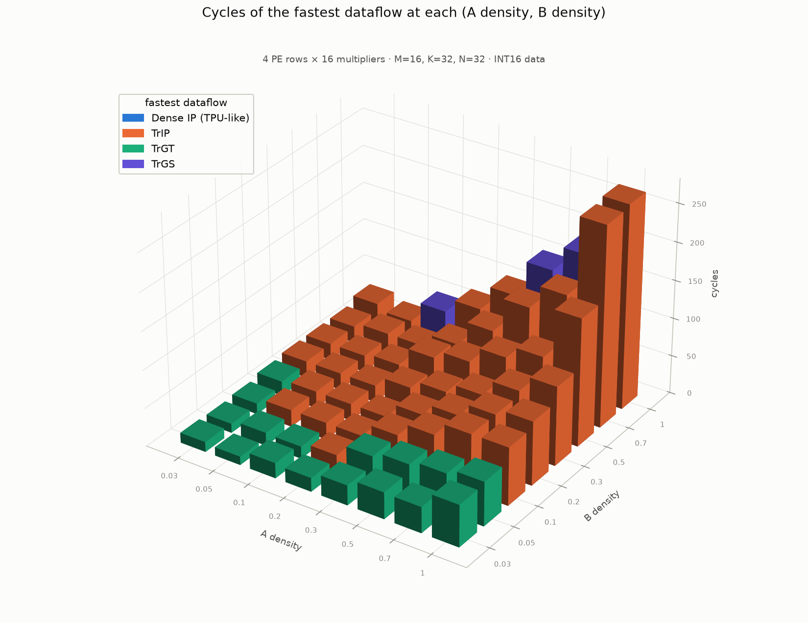
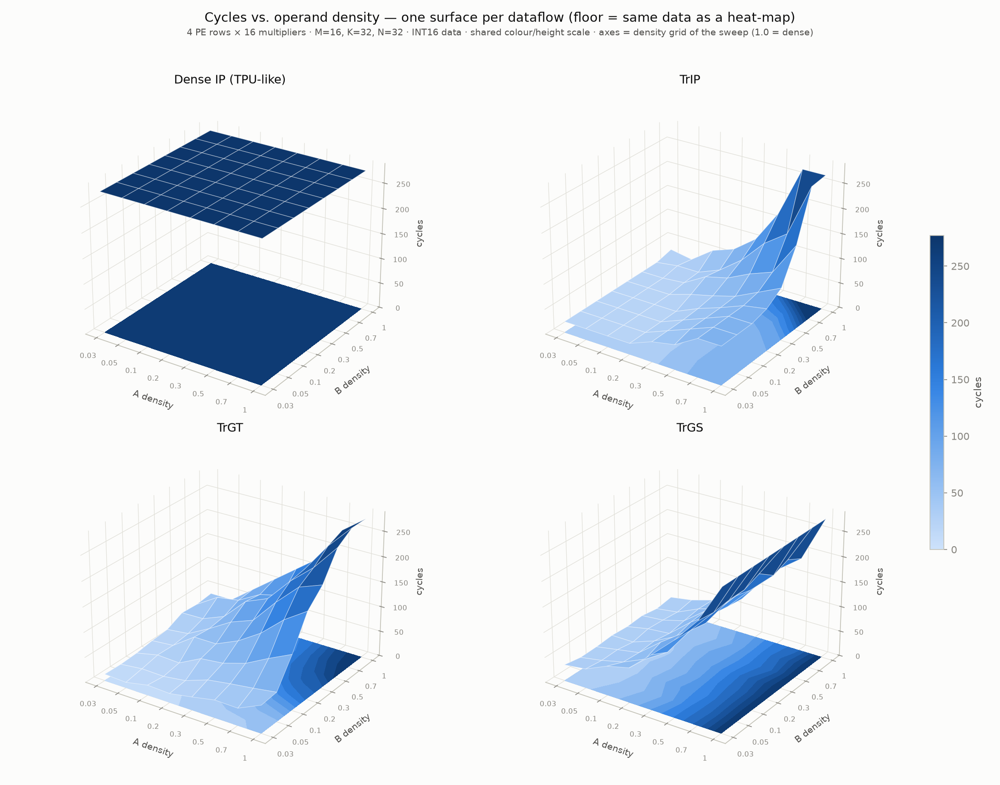
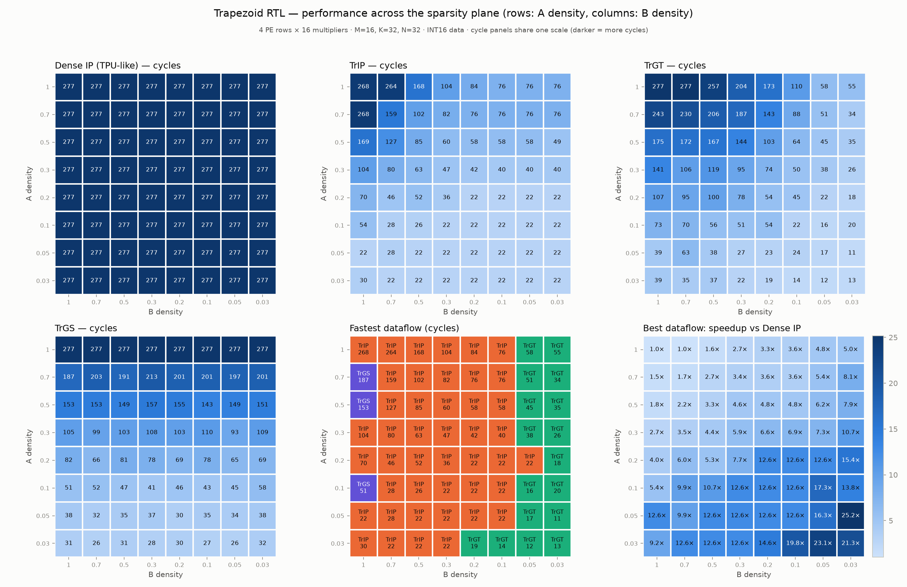
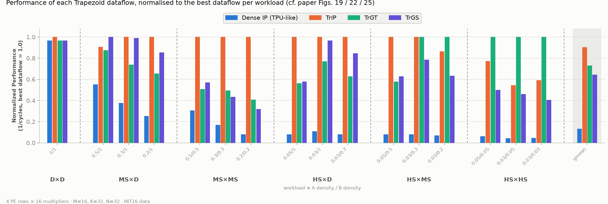
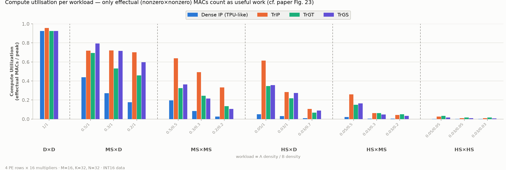

# Trapezoid RTL sweep results

- unit test: **PASS**, sweep (260 runs, all checked vs reference matmul): **PASS**
- config: 4 PE rows x 16 multipliers, M=16 K=32 N=32 (ragged case listed at the end)
- rows of every table = density of A, columns = density of B

## DENSE: cycles

| dA \ dB | 1 | 0.7 | 0.5 | 0.3 | 0.2 | 0.1 | 0.05 | 0.03 |
|---|---|---|---|---|---|---|---|---|
| **1** | 277 | 277 | 277 | 277 | 277 | 277 | 277 | 277 |
| **0.7** | 277 | 277 | 277 | 277 | 277 | 277 | 277 | 277 |
| **0.5** | 277 | 277 | 277 | 277 | 277 | 277 | 277 | 277 |
| **0.3** | 277 | 277 | 277 | 277 | 277 | 277 | 277 | 277 |
| **0.2** | 277 | 277 | 277 | 277 | 277 | 277 | 277 | 277 |
| **0.1** | 277 | 277 | 277 | 277 | 277 | 277 | 277 | 277 |
| **0.05** | 277 | 277 | 277 | 277 | 277 | 277 | 277 | 277 |
| **0.03** | 277 | 277 | 277 | 277 | 277 | 277 | 277 | 277 |

## TRIP: cycles

| dA \ dB | 1 | 0.7 | 0.5 | 0.3 | 0.2 | 0.1 | 0.05 | 0.03 |
|---|---|---|---|---|---|---|---|---|
| **1** | 268 | 264 | 168 | 104 | 84 | 76 | 76 | 76 |
| **0.7** | 268 | 159 | 102 | 82 | 76 | 76 | 76 | 76 |
| **0.5** | 169 | 127 | 85 | 60 | 58 | 58 | 58 | 49 |
| **0.3** | 104 | 80 | 63 | 47 | 42 | 40 | 40 | 40 |
| **0.2** | 70 | 46 | 52 | 36 | 22 | 22 | 22 | 22 |
| **0.1** | 54 | 28 | 26 | 22 | 22 | 22 | 22 | 22 |
| **0.05** | 22 | 28 | 22 | 22 | 22 | 22 | 22 | 22 |
| **0.03** | 30 | 22 | 22 | 22 | 22 | 22 | 22 | 22 |

## TRGT: cycles

| dA \ dB | 1 | 0.7 | 0.5 | 0.3 | 0.2 | 0.1 | 0.05 | 0.03 |
|---|---|---|---|---|---|---|---|---|
| **1** | 277 | 277 | 257 | 204 | 173 | 110 | 58 | 55 |
| **0.7** | 243 | 230 | 206 | 187 | 143 | 88 | 51 | 34 |
| **0.5** | 175 | 172 | 167 | 144 | 103 | 64 | 45 | 35 |
| **0.3** | 141 | 106 | 119 | 95 | 74 | 50 | 38 | 26 |
| **0.2** | 107 | 95 | 100 | 78 | 54 | 45 | 22 | 18 |
| **0.1** | 73 | 70 | 56 | 51 | 54 | 22 | 16 | 20 |
| **0.05** | 39 | 63 | 38 | 27 | 23 | 24 | 17 | 11 |
| **0.03** | 39 | 35 | 37 | 22 | 19 | 14 | 12 | 13 |

## TRGS: cycles

| dA \ dB | 1 | 0.7 | 0.5 | 0.3 | 0.2 | 0.1 | 0.05 | 0.03 |
|---|---|---|---|---|---|---|---|---|
| **1** | 277 | 277 | 277 | 277 | 277 | 277 | 277 | 277 |
| **0.7** | 187 | 203 | 191 | 213 | 201 | 201 | 197 | 201 |
| **0.5** | 153 | 153 | 149 | 157 | 155 | 143 | 149 | 151 |
| **0.3** | 105 | 99 | 103 | 108 | 103 | 110 | 93 | 109 |
| **0.2** | 82 | 66 | 81 | 78 | 69 | 78 | 65 | 69 |
| **0.1** | 51 | 52 | 47 | 41 | 46 | 43 | 45 | 58 |
| **0.05** | 38 | 32 | 35 | 37 | 30 | 35 | 34 | 38 |
| **0.03** | 31 | 26 | 31 | 28 | 30 | 27 | 26 | 32 |

## TRIP: speedup vs Dense

| dA \ dB | 1 | 0.7 | 0.5 | 0.3 | 0.2 | 0.1 | 0.05 | 0.03 |
|---|---|---|---|---|---|---|---|---|
| **1** | 1.0x | 1.0x | 1.6x | 2.7x | 3.3x | 3.6x | 3.6x | 3.6x |
| **0.7** | 1.0x | 1.7x | 2.7x | 3.4x | 3.6x | 3.6x | 3.6x | 3.6x |
| **0.5** | 1.6x | 2.2x | 3.3x | 4.6x | 4.8x | 4.8x | 4.8x | 5.7x |
| **0.3** | 2.7x | 3.5x | 4.4x | 5.9x | 6.6x | 6.9x | 6.9x | 6.9x |
| **0.2** | 4.0x | 6.0x | 5.3x | 7.7x | 12.6x | 12.6x | 12.6x | 12.6x |
| **0.1** | 5.1x | 9.9x | 10.7x | 12.6x | 12.6x | 12.6x | 12.6x | 12.6x |
| **0.05** | 12.6x | 9.9x | 12.6x | 12.6x | 12.6x | 12.6x | 12.6x | 12.6x |
| **0.03** | 9.2x | 12.6x | 12.6x | 12.6x | 12.6x | 12.6x | 12.6x | 12.6x |

## TRGT: speedup vs Dense

| dA \ dB | 1 | 0.7 | 0.5 | 0.3 | 0.2 | 0.1 | 0.05 | 0.03 |
|---|---|---|---|---|---|---|---|---|
| **1** | 1.0x | 1.0x | 1.1x | 1.4x | 1.6x | 2.5x | 4.8x | 5.0x |
| **0.7** | 1.1x | 1.2x | 1.3x | 1.5x | 1.9x | 3.1x | 5.4x | 8.1x |
| **0.5** | 1.6x | 1.6x | 1.7x | 1.9x | 2.7x | 4.3x | 6.2x | 7.9x |
| **0.3** | 2.0x | 2.6x | 2.3x | 2.9x | 3.7x | 5.5x | 7.3x | 10.7x |
| **0.2** | 2.6x | 2.9x | 2.8x | 3.6x | 5.1x | 6.2x | 12.6x | 15.4x |
| **0.1** | 3.8x | 4.0x | 4.9x | 5.4x | 5.1x | 12.6x | 17.3x | 13.8x |
| **0.05** | 7.1x | 4.4x | 7.3x | 10.3x | 12.0x | 11.5x | 16.3x | 25.2x |
| **0.03** | 7.1x | 7.9x | 7.5x | 12.6x | 14.6x | 19.8x | 23.1x | 21.3x |

## TRGS: speedup vs Dense

| dA \ dB | 1 | 0.7 | 0.5 | 0.3 | 0.2 | 0.1 | 0.05 | 0.03 |
|---|---|---|---|---|---|---|---|---|
| **1** | 1.0x | 1.0x | 1.0x | 1.0x | 1.0x | 1.0x | 1.0x | 1.0x |
| **0.7** | 1.5x | 1.4x | 1.5x | 1.3x | 1.4x | 1.4x | 1.4x | 1.4x |
| **0.5** | 1.8x | 1.8x | 1.9x | 1.8x | 1.8x | 1.9x | 1.9x | 1.8x |
| **0.3** | 2.6x | 2.8x | 2.7x | 2.6x | 2.7x | 2.5x | 3.0x | 2.5x |
| **0.2** | 3.4x | 4.2x | 3.4x | 3.6x | 4.0x | 3.6x | 4.3x | 4.0x |
| **0.1** | 5.4x | 5.3x | 5.9x | 6.8x | 6.0x | 6.4x | 6.2x | 4.8x |
| **0.05** | 7.3x | 8.7x | 7.9x | 7.5x | 9.2x | 7.9x | 8.1x | 7.3x |
| **0.03** | 8.9x | 10.7x | 8.9x | 9.9x | 9.2x | 10.3x | 10.7x | 8.7x |

## DENSE: multiplier utilization (effectual MACs / (cycles x 64))

| dA \ dB | 1 | 0.7 | 0.5 | 0.3 | 0.2 | 0.1 | 0.05 | 0.03 |
|---|---|---|---|---|---|---|---|---|
| **1** | 92.4% | 61.9% | 43.2% | 26.4% | 17.9% | 9.0% | 3.6% | 3.2% |
| **0.7** | 58.3% | 39.4% | 25.9% | 19.4% | 11.3% | 5.7% | 2.5% | 1.4% |
| **0.5** | 43.9% | 29.7% | 19.5% | 11.5% | 8.1% | 3.5% | 1.9% | 1.3% |
| **0.3** | 27.1% | 16.3% | 13.0% | 8.3% | 5.0% | 2.5% | 0.9% | 0.7% |
| **0.2** | 17.7% | 9.8% | 8.6% | 5.2% | 2.6% | 1.5% | 0.8% | 0.3% |
| **0.1** | 9.7% | 5.7% | 3.7% | 1.8% | 1.0% | 0.6% | 0.3% | 0.3% |
| **0.05** | 4.9% | 2.7% | 2.1% | 1.0% | 0.5% | 0.3% | 0.2% | 0.1% |
| **0.03** | 3.1% | 0.8% | 1.0% | 0.5% | 0.3% | 0.2% | 0.1% | 0.1% |

## TRIP: multiplier utilization (effectual MACs / (cycles x 64))

| dA \ dB | 1 | 0.7 | 0.5 | 0.3 | 0.2 | 0.1 | 0.05 | 0.03 |
|---|---|---|---|---|---|---|---|---|
| **1** | 95.5% | 65.0% | 71.3% | 70.4% | 58.9% | 32.9% | 13.2% | 11.5% |
| **0.7** | 60.3% | 68.6% | 70.3% | 65.4% | 41.4% | 20.8% | 9.1% | 5.1% |
| **0.5** | 71.9% | 64.9% | 63.7% | 53.1% | 38.7% | 16.8% | 9.3% | 7.3% |
| **0.3** | 72.1% | 56.6% | 57.3% | 49.2% | 33.3% | 17.1% | 6.6% | 4.5% |
| **0.2** | 70.0% | 59.2% | 45.9% | 39.8% | 33.1% | 19.3% | 9.7% | 4.0% |
| **0.1** | 50.0% | 56.2% | 39.5% | 22.8% | 12.9% | 7.6% | 3.6% | 3.8% |
| **0.05** | 61.4% | 26.5% | 26.0% | 12.0% | 6.3% | 4.4% | 2.6% | 1.5% |
| **0.03** | 28.3% | 10.6% | 12.3% | 6.1% | 4.3% | 2.4% | 0.9% | 0.9% |

## TRGT: multiplier utilization (effectual MACs / (cycles x 64))

| dA \ dB | 1 | 0.7 | 0.5 | 0.3 | 0.2 | 0.1 | 0.05 | 0.03 |
|---|---|---|---|---|---|---|---|---|
| **1** | 92.4% | 61.9% | 46.6% | 35.9% | 28.6% | 22.7% | 17.2% | 15.9% |
| **0.7** | 66.5% | 47.4% | 34.8% | 28.7% | 22.0% | 18.0% | 13.5% | 11.4% |
| **0.5** | 69.4% | 47.9% | 32.4% | 22.1% | 21.8% | 15.2% | 11.9% | 10.2% |
| **0.3** | 53.2% | 42.7% | 30.4% | 24.3% | 18.9% | 13.7% | 6.9% | 7.0% |
| **0.2** | 45.8% | 28.7% | 23.8% | 18.4% | 13.5% | 9.4% | 9.7% | 4.9% |
| **0.1** | 37.0% | 22.5% | 18.3% | 9.8% | 5.3% | 7.6% | 5.0% | 4.2% |
| **0.05** | 34.6% | 11.8% | 15.0% | 9.8% | 6.0% | 4.0% | 3.4% | 3.0% |
| **0.03** | 21.8% | 6.7% | 7.3% | 6.1% | 5.0% | 3.8% | 1.7% | 1.6% |

## TRGS: multiplier utilization (effectual MACs / (cycles x 64))

| dA \ dB | 1 | 0.7 | 0.5 | 0.3 | 0.2 | 0.1 | 0.05 | 0.03 |
|---|---|---|---|---|---|---|---|---|
| **1** | 92.4% | 61.9% | 43.2% | 26.4% | 17.9% | 9.0% | 3.6% | 3.2% |
| **0.7** | 86.4% | 53.7% | 37.5% | 25.2% | 15.6% | 7.9% | 3.5% | 1.9% |
| **0.5** | 79.4% | 53.9% | 36.3% | 20.3% | 14.5% | 6.8% | 3.6% | 2.4% |
| **0.3** | 71.4% | 45.7% | 35.1% | 21.4% | 13.6% | 6.2% | 2.8% | 1.7% |
| **0.2** | 59.8% | 41.3% | 29.4% | 18.4% | 10.6% | 5.4% | 3.3% | 1.3% |
| **0.1** | 52.9% | 30.3% | 21.8% | 12.2% | 6.2% | 3.9% | 1.8% | 1.5% |
| **0.05** | 35.5% | 23.2% | 16.3% | 7.1% | 4.6% | 2.8% | 1.7% | 0.9% |
| **0.03** | 27.4% | 9.0% | 8.7% | 4.8% | 3.2% | 2.0% | 0.8% | 0.6% |

## Best dataflow per (dA, dB) point (fewest cycles)

| dA \ dB | 1 | 0.7 | 0.5 | 0.3 | 0.2 | 0.1 | 0.05 | 0.03 |
|---|---|---|---|---|---|---|---|---|
| **1** | TRIP (268) | TRIP (264) | TRIP (168) | TRIP (104) | TRIP (84) | TRIP (76) | TRGT (58) | TRGT (55) |
| **0.7** | TRGS (187) | TRIP (159) | TRIP (102) | TRIP (82) | TRIP (76) | TRIP (76) | TRGT (51) | TRGT (34) |
| **0.5** | TRGS (153) | TRIP (127) | TRIP (85) | TRIP (60) | TRIP (58) | TRIP (58) | TRGT (45) | TRGT (35) |
| **0.3** | TRIP (104) | TRIP (80) | TRIP (63) | TRIP (47) | TRIP (42) | TRIP (40) | TRGT (38) | TRGT (26) |
| **0.2** | TRIP (70) | TRIP (46) | TRIP (52) | TRIP (36) | TRIP (22) | TRIP (22) | TRIP (22) | TRGT (18) |
| **0.1** | TRGS (51) | TRIP (28) | TRIP (26) | TRIP (22) | TRIP (22) | TRIP (22) | TRGT (16) | TRGT (20) |
| **0.05** | TRIP (22) | TRIP (28) | TRIP (22) | TRIP (22) | TRIP (22) | TRIP (22) | TRGT (17) | TRGT (11) |
| **0.03** | TRIP (30) | TRIP (22) | TRIP (22) | TRIP (22) | TRGT (19) | TRGT (14) | TRGT (12) | TRGT (13) |

## Gustavson traffic proxy: B nonzeros streamed (TrGT / TrGS), e.g. at dB=0.2

| dA | TrGT | TrGS |
|---|---|---|
| 1 | 3168 | 3168 |
| 0.7 | 2012 | 2012 |
| 0.5 | 1436 | 1436 |
| 0.3 | 895 | 895 |
| 0.2 | 466 | 466 |
| 0.1 | 182 | 182 |
| 0.05 | 89 | 89 |
| 0.03 | 61 | 61 |

## Ragged shape M=13 K=21 N=19, dA=dB=0.3

| mode | cycles | issued MACs | effectual MACs |
|---|---|---|---|
| DENSE | 173 | 5187 | 361 |
| TRIP | 23 | 361 | 361 |
| TRGT | 36 | 361 | 361 |
| TRGS | 61 | 361 | 361 |

## Figures

