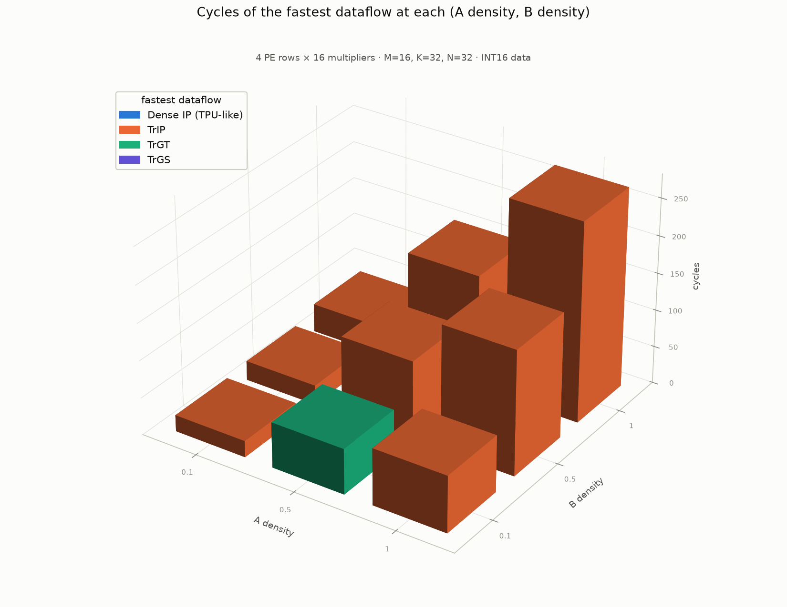
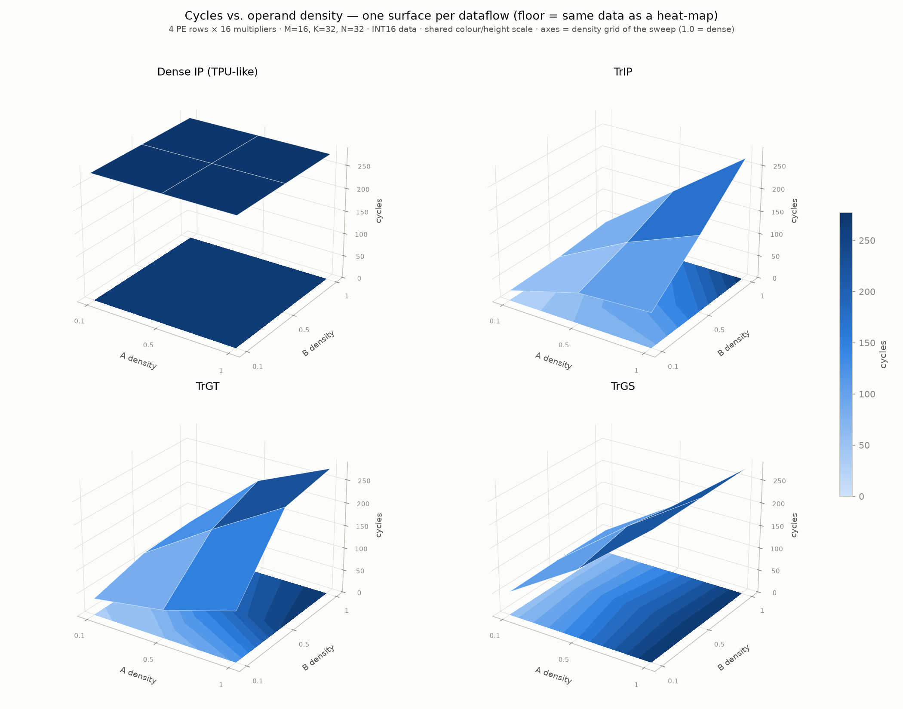
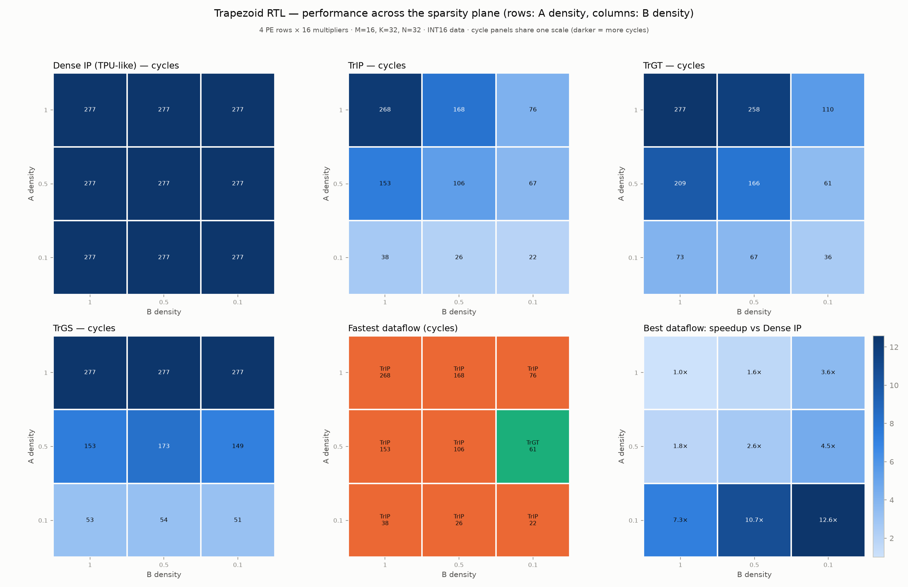
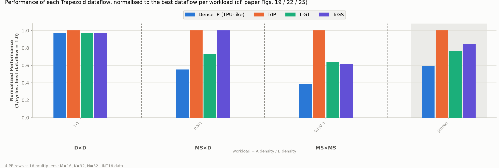
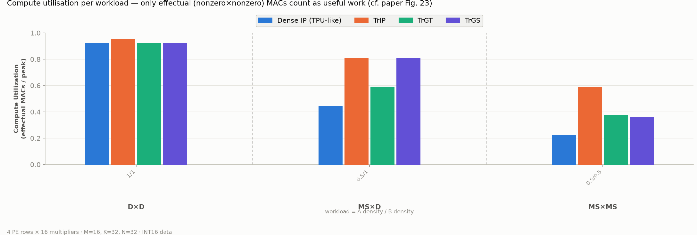

# Parameterized Trapezoid Sweep Results

- **Matrix Shape**: M=16, K=32, N=32
- **Hardware Array**: 4 PE rows × 16 multipliers per row (64 peak MACs/cycle)
- **Total Benchmark Runs**: 40 runs (checked vs reference matmul)

## DENSE: Cycles

| dA \ dB | 1 | 0.5 | 0.1 |
|---|---|---|---|
| **1** | 277 | 277 | 277 |
| **0.5** | 277 | 277 | 277 |
| **0.1** | 277 | 277 | 277 |

## TRIP: Cycles

| dA \ dB | 1 | 0.5 | 0.1 |
|---|---|---|---|
| **1** | 268 | 168 | 76 |
| **0.5** | 153 | 106 | 67 |
| **0.1** | 38 | 26 | 22 |

## TRGT: Cycles

| dA \ dB | 1 | 0.5 | 0.1 |
|---|---|---|---|
| **1** | 277 | 258 | 110 |
| **0.5** | 209 | 166 | 61 |
| **0.1** | 73 | 67 | 36 |

## TRGS: Cycles

| dA \ dB | 1 | 0.5 | 0.1 |
|---|---|---|---|
| **1** | 277 | 277 | 277 |
| **0.5** | 153 | 173 | 149 |
| **0.1** | 53 | 54 | 51 |

## TRIP: Speedup vs DENSE

| dA \ dB | 1 | 0.5 | 0.1 |
|---|---|---|---|
| **1** | 1.0x | 1.6x | 3.6x |
| **0.5** | 1.8x | 2.6x | 4.1x |
| **0.1** | 7.3x | 10.7x | 12.6x |

## TRGT: Speedup vs DENSE

| dA \ dB | 1 | 0.5 | 0.1 |
|---|---|---|---|
| **1** | 1.0x | 1.1x | 2.5x |
| **0.5** | 1.3x | 1.7x | 4.5x |
| **0.1** | 3.8x | 4.1x | 7.7x |

## TRGS: Speedup vs DENSE

| dA \ dB | 1 | 0.5 | 0.1 |
|---|---|---|---|
| **1** | 1.0x | 1.0x | 1.0x |
| **0.5** | 1.8x | 1.6x | 1.9x |
| **0.1** | 5.2x | 5.1x | 5.4x |

## Multiplier Utilization (Effectual MACs / Peak MACs)

### DENSE Utilization

| dA \ dB | 1 | 0.5 | 0.1 |
|---|---|---|---|
| **1** | 92.4% | 44.7% | 9.8% |
| **0.5** | 44.6% | 22.5% | 3.3% |
| **0.1** | 9.7% | 5.0% | 0.9% |

### TRIP Utilization

| dA \ dB | 1 | 0.5 | 0.1 |
|---|---|---|---|
| **1** | 95.5% | 73.7% | 35.9% |
| **0.5** | 80.7% | 58.8% | 13.8% |
| **0.1** | 71.1% | 53.2% | 11.8% |

### TRGT Utilization

| dA \ dB | 1 | 0.5 | 0.1 |
|---|---|---|---|
| **1** | 92.4% | 48.0% | 24.8% |
| **0.5** | 59.1% | 37.5% | 15.2% |
| **0.1** | 37.0% | 20.7% | 7.2% |

### TRGS Utilization

| dA \ dB | 1 | 0.5 | 0.1 |
|---|---|---|---|
| **1** | 92.4% | 44.7% | 9.8% |
| **0.5** | 80.7% | 36.0% | 6.2% |
| **0.1** | 50.9% | 25.6% | 5.1% |

## Best Dataflow per Density Pair (Fewest Cycles)

| dA \ dB | 1 | 0.5 | 0.1 |
|---|---|---|---|
| **1** | TRIP (268) | TRIP (168) | TRIP (76) |
| **0.5** | TRIP (153) | TRIP (106) | TRGT (61) |
| **0.1** | TRIP (38) | TRIP (26) | TRIP (22) |

## Ragged Test Cases

| Case | Shape (M,K,N) | dA | dB | Mode | Cycles | Issued MACs | Effectual MACs |
|---|---|---|---|---|---|---|---|
| ragged | (13,21,19) | 0.3 | 0.3 | DENSE | 173 | 5187 | 478 |
| ragged | (13,21,19) | 0.3 | 0.3 | TRIP | 24 | 478 | 478 |
| ragged | (13,21,19) | 0.3 | 0.3 | TRGT | 49 | 478 | 478 |
| ragged | (13,21,19) | 0.3 | 0.3 | TRGS | 69 | 478 | 478 |

## Generated Plots

